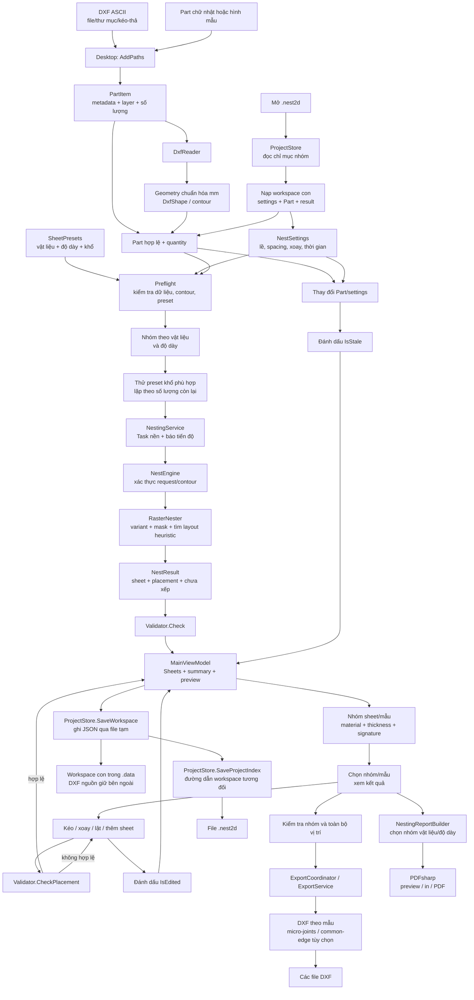

# Cyclone Nest2D — hướng dẫn kiến trúc và luồng hoạt động

> Tài liệu dành cho lập trình viên mới và AI coding agent tiếp nhận dự án. Hãy đọc tài liệu này cùng `README.md`; README ưu tiên hướng dẫn người dùng, tài liệu này giải thích cấu trúc và luồng nội bộ.

## 1. Mục tiêu và phạm vi

Cyclone Nest2D là ứng dụng desktop Windows dùng WPF để đọc hình học chi tiết từ DXF ASCII, chuẩn hóa về mm, tìm cách bố trí các chi tiết trên các khổ tấm, cho phép điều chỉnh thủ công, kiểm tra độc lập kết quả và xuất DXF/PDF/báo cáo. Thuật toán lõi và UI Core nhắm `.NET 8`; Desktop nhắm `net8.0-windows` và phụ thuộc WPF.

Điểm quan trọng về miền nghiệp vụ: với chi tiết DXF, hệ thống phải dùng contour thật. Nếu contour ngoài không thể xác minh thì phải báo lỗi và từ chối nesting; không được lặng lẽ thay bằng hình chữ nhật hộp bao. Hộp bao được dùng cho kích thước, vùng lọc, giới hạn tìm kiếm và hiển thị, không thay thế phép xác minh hình học.

## 2. Bản đồ thư mục

| Đường dẫn | Trách nhiệm |
|---|---|
| `src/CycloneNest2D.Core/` | Miền hình học, đọc DXF, thuật toán nesting, validator và xuất DXF. Không phụ thuộc WPF. |
| `src/CycloneNest2D.UI.Core/` | ViewModel/MVVM, quy tắc ứng dụng, quản lý Part, chạy nesting nền, preview scene, cấu hình, lưu/mở dự án, điều phối xuất. Nhắm `net8.0`, có thể kiểm thử ngoài Windows. |
| `src/CycloneNest2D.Desktop/` | Ứng dụng WPF Windows: XAML, cửa sổ, canvas/vẽ, tương tác chuột/bàn phím, hộp thoại, PDF. Nên giữ lớp này chủ yếu là UI và adapter. |
| `tests/CycloneNest2D.Tests/` | xUnit tests theo domain cho hình học, DXF, nesting, validator và xuất. |
| `tests/CycloneNest2D.UI.Tests/` | xUnit tests cho UI Core, persistence, thao tác placement và kiểm tra tĩnh XAML; không phải kiểm thử tương tác WPF thực. |
| `tests/CycloneNest2D.Performance/` | Benchmark console riêng cho throughput/chất lượng nesting; chạy workload tổng hợp hoặc DXF thật, xuất báo cáo JSON/CSV. |
| `CycloneNest2D.sln` | Solution Visual Studio. |

### Các tệp Core quan trọng

- `DxfReader.cs`: đọc DXF ASCII, entities/layers/đơn vị/block; lọc layer, suy ra vùng/kích thước, chuẩn hóa tọa độ thành mm và tạo `DxfPart`.
- `Geometry.cs`: kiểu hình cơ sở và phép biến đổi affine.
- `DxfShape.cs`: hình học chi tiết theo các segment `LINE`/`ARC`/`CIRCLE`; đưa hình vào vị trí và hướng đặt.
- `ShapeGeometry.cs`: nối segment thành loop/contour, xác định biên ngoài/lỗ, diện tích, phép thử khoảng cách/chứa nhau và xoay.
- `NestEngine.cs`: kiểm tra contour trước khi giao việc cho thuật toán raster.
- `RasterNester.cs`: xếp theo mặt nạ bit bảo thủ, nhiều thứ tự thử và thời hạn/điều kiện dừng.
- `Validator.cs`: kiểm tra kết quả sau nesting hoặc vị trí kéo/xoay thủ công, độc lập với bộ tìm ứng viên.
- `Export.cs`, `DxfExportWriter.cs`, `DxfExportOptions.cs`, `MicroJointProcessor.cs`: API/định dạng xuất DXF; micro-joints phân bổ khe cầu trên cả contour ngoài và đường bao lỗ đủ kích thước, tự bỏ qua contour nhỏ.

### Các tệp UI Core quan trọng

- `MainViewModel.cs`: trạng thái chính của ứng dụng, commands, danh sách Part, preflight, chạy theo nhóm vật liệu/độ dày, kết quả, thao tác thủ công và trạng thái stale.
- `PartItem.cs`: biểu diễn chi tiết trong UI, gồm nguồn DXF hoặc hình chữ nhật, số lượng, layer được bật, metadata vật liệu/độ dày và tính hợp lệ.
- `NestSettings.cs`: thiết lập, kiểm tra đầu vào, chuyển sang `SheetDefinition`/`NestOptions`.
- `NestingService.cs`: chuyển tác vụ Core sang `Task.Run`, sau đó chạy `Validator.Check`.
- `ProjectStore.cs`: serialize dự án `.nest2d` JSON; đường dẫn DXF ghi tương đối với dự án. `ProjectFormatMigrator.cs` nâng dữ liệu workspace v1 và project/workspace v2 lên schema v3 trong bộ nhớ trước khi nạp.
- `Preview.cs`: dựng scene xem trước và hit-test hình dạng.
- `ExportService.cs`: điều phối xuất một file hoặc nhiều file và tạo nội dung tóm tắt.

### Các tệp Desktop quan trọng

- `App.xaml`/`App.xaml.cs`: resources, theme và khởi tạo ứng dụng.
- `MainWindow.xaml`/`MainWindow.xaml.cs`: giao diện chính, bind tới ViewModel, nhận kéo-thả, menu/hộp thoại và lifecycle cửa sổ.
- `SheetView.cs`: vẽ tấm, zoom/pan, hit-test, kéo chi tiết đã đặt và phím tắt; placement mới từ Bộ lọc chi tiết được quy đổi về tọa độ tấm trong `MainWindow`, còn quyết định cuối cùng về tính hợp lệ thuộc Core.
- `SheetThumbnailView.cs`, `PartPreviewView.cs`: biểu diễn preview phụ.
- `PdfReportWriter.cs`, `ReportPreviewWindow.cs`, `NestingReport.cs`: dựng và xem trước báo cáo PDF.
- `DxfExportDialog.cs`, `PdfExportOptionsWindow.cs`: hộp thoại cấu hình xuất; các thiết lập nesting chính được bind trực tiếp trên tab **Thiết lập** trong `MainWindow.xaml`.

## 3. Luồng khởi động và phụ thuộc

```text
CycloneNest2D.Desktop (WPF) ──> CycloneNest2D.UI.Core ──> CycloneNest2D.Core
CycloneNest2D.Tests ─────────────────────────────> CycloneNest2D.Core
CycloneNest2D.UI.Tests ──────────────────────────> CycloneNest2D.UI.Core ──> CycloneNest2D.Core
```

Desktop tạo `MainViewModel` cùng dịch vụ hộp thoại WPF (`WpfDialogService`) và gắn binding/view. UI Core tránh phụ thuộc WPF để logic có thể chạy và test trên hệ điều hành khác.

## 4. Luồng người dùng: từ DXF đến kết quả

### 4.1 Thêm chi tiết

Người dùng chọn file/thư mục hoặc kéo-thả vào cửa sổ. `MainWindow` chuyển đường dẫn cho `MainViewModel.AddPaths(...)`. ViewModel liệt kê DXF (thư mục hiện chỉ quét cấp trên), bỏ qua file trùng theo đường dẫn đầy đủ, rồi gọi `PartItem.FromDxf`/`DxfReader.Read`.

Trong `DxfReader`, chuỗi xử lý chính:

1. `ReadRaw` nạp DXF ASCII, phân tích header, blocks và entity; chuẩn hóa INSERT/transform, ghi warning cho entity chưa hỗ trợ.
2. Chọn layer: nếu người dùng chỉ định `IncludeLayers` thì dùng đúng layer đó; nếu không, loại layer có từ khóa mặc định như BEND/DIM/TEXT.
3. Chọn layer xác định kích thước. Nếu có `OUTER_PROFILE`, layer đó quyết định hộp bao; nếu không, dùng các layer đầu ra.
4. Hình học nằm ngoài vùng chi tiết được loại khỏi output và cảnh báo.
5. Lấy tỉ lệ đơn vị từ `$INSUNITS`, option cưỡng bức, hoặc giả định mm có warning.
6. Biến đổi tất cả hình hợp lệ sang mm, đưa góc hộp bao về (0,0), chuyển thành các segment của `DxfShape`.
7. Phân tích quy ước tên file `_xN` (số lượng) và `_norot` (cấm xoay).

`PartItem` giữ nguồn file/layer để có thể nạp lại hình khi người dùng bật/tắt layer. Kiểm tra dữ liệu đầu vào xem cả geometry, kích thước và số lượng.

### 4.2 Thiết lập và preflight

Người dùng cấu hình tự động xoay, hướng ưu tiên lấp, bước xoay, thời gian tối đa, hiệu suất mục tiêu và lề/khoảng cách trên tab **Thiết lập**; presets vật liệu/độ dày và kích thước tấm được quản lý tại trang **Sheets**. Trên thanh điều hướng bên trái, tab Thiết lập là mục độc lập sau Export. Khi chạy, `MainViewModel.RunAsync`:

1. Chặn nếu đang chạy; gọi `NestSettings.Validate`.
2. Chia các Part hợp lệ và bỏ qua Part không hợp lệ/số lượng không dương.
3. Kiểm tra metadata vật liệu/độ dày, preset khổ phù hợp và contour DXF (`ShapeOps.Build`). Contour không đáng tin cậy sẽ dừng trước khi nest.
4. Làm tên chi tiết duy nhất vì tên là khóa dùng để ghép placement về số lượng còn lại.
5. Khởi tạo cancellation token, trạng thái tiến độ và đồng hồ tổng.

### 4.3 Nhóm vật liệu và khổ tấm

Các Part được gom theo khóa vật liệu (trim + uppercase) và độ dày làm tròn 4 chữ số thập phân. Mỗi nhóm chỉ xét preset khổ tấm có cùng vật liệu/độ dày. Mỗi vòng lặp:

1. Tạo `PartDefinition` với quantity còn lại.
2. Thử các preset khổ thích hợp, phân bổ phần thời gian còn lại giữa các lượt thử.
3. Chọn phương án theo số chi tiết đặt trên tấm đầu tiên, sau đó utilization và diện tích khổ.
4. Nếu chỉ có một khổ, áp dụng mọi sheet trong kết quả trial; nếu nhiều khổ, lấy sheet đầu tiên của phương án tốt nhất rồi lặp lại lựa chọn.
5. Gán lại instance number toàn cục trong nhóm, giảm số lượng còn lại, ghi chú sheet.
6. Dừng theo hoàn tất, hết thời gian hoặc cancellation; ghi rõ phần chưa xếp.

Lưu ý: dữ liệu dự án hiện lưu danh sách preset nhưng không có tồn kho vật liệu; số sheet được tạo theo lượng cần dùng. Quy tắc so khớp preset và cách chọn khổ là điểm cần giữ nhất quán khi sửa UI Core.

### 4.4 Thuật toán nesting lõi

`NestEngine.Run` chặn các contour không tin cậy rồi gọi `RasterNester.Run`.

`RasterNester` chọn cell size thích ứng theo kích thước khổ, chi tiết nhỏ nhất, spacing, độ phức tạp contour và giới hạn bộ nhớ/lưới. Lưới raster được xây bảo thủ: ô chạm vật liệu được đánh dấu chiếm, nhưng vùng lỗ được giữ trống. Các part đặt trước được giãn theo khe hở. Thuật toán dùng phép toán bit để tìm vị trí ứng viên nhanh; trước khi xác minh chính xác bằng hình học (`ShapeOps.Conflict`), Verify dùng danh sách placement sắp theo X cùng giới hạn kích thước lớn nhất để bỏ qua các placement chắc chắn nằm ngoài vùng lân cận. Phép lọc này chỉ loại cặp không thể chạm theo X; kiểm tra khoảng cách/hộp bao và contour thật vẫn được giữ nguyên.

Với bước xoay mịn, variant 0°/90°/180°/270° được dựng và thử trước. Khi bật target, engine dành tối đa 20% ngân sách cho lượt coarse nhanh; nếu chưa đạt target, phần góc mịn theo `RotationStep` chỉ được dựng/thử tiếp khi còn thời gian. Khi tắt target, góc mịn cũng được mở rộng nếu còn ngân sách. Các orientation không thuộc lưới góc người dùng chọn không được tự thêm. Cell size chỉ refinement khi chi tiết nhỏ hoặc spacing nhỏ so với lưới theo khổ; refinement bị chặn ở mức tăng tối đa 25% số ô và vẫn tuân thủ giới hạn raster. Độ phức tạp contour có thể chọn ô lớn hơn để giới hạn raster work. Thuật toán thử thứ tự theo diện tích, cạnh dài, cạnh ngắn và chu vi, sau đó có thể tìm kiếm cục bộ với seed cố định; các lượt thứ tự chạy song song nên seed không bảo đảm toàn bộ kết quả tất định khi có dừng sớm/thời hạn. `MaxSeconds` bị giới hạn trong khoảng nội bộ 0.05–3600 giây.

`NestResult` mang sheet, placement, utilization, ghi chú, chiến lược và danh sách chưa đặt. Utilization dùng diện tích vật liệu thật (không tính lỗ), theo mô tả trong README. Khi có lỗ/contour lõm, hộp bao không thể dùng để kết luận va chạm.

Core xác thực kích thước tấm và bước xoay (5–180°) ngay cả khi được gọi ngoài UI. Một lần chạy bị giới hạn tối đa 250.000 instance; lưới raster tối đa 8192 ô mỗi chiều và 16.777.216 ô tổng. Đầu vào vượt giới hạn bị từ chối với thông báo thay vì tạo danh sách/cấp phát lưới không kiểm soát. Các vòng lặp raster kiểm tra cancellation định kỳ; hủy được thể hiện riêng với hết thời gian và các chi tiết chưa xử lý vẫn được báo rõ.

`RasterNester.GapTol` là dung sai 0,1 mm do rời rạc hóa cung tròn. Với contour thật, bước xác minh chính xác dùng `max(0, SheetDefinition.Spacing - GapTol)`: khoảng cách biên có thể thấp hơn spacing cấu hình tối đa 0,1 mm, nhưng không chấp nhận chồng lấn. Validator dùng cùng ngưỡng cho placement có contour thật; hai placement chữ nhật kiểm tra spacing chính xác theo hộp bao. Đây là dung sai xác minh, không phải thay đổi lề hoặc giá trị spacing lưu trong thiết lập.

#### Kiểm kê thuật toán đang triển khai

| Thành phần | Cách thực hiện hiện tại | Giới hạn cần hiểu |
|---|---|---|
| Đọc và chuẩn hóa DXF | Đọc DXF ASCII theo group code; xử lý LINE, CIRCLE, ARC, LWPOLYLINE, POLYLINE, ELLIPSE, SPLINE, INSERT, TEXT và MTEXT. INSERT áp dụng transform/block; ellipse và spline được xấp xỉ bằng các đoạn thẳng. Layer, `$INSUNITS`/đơn vị cưỡng bức, hộp bao và gốc tọa độ được chuẩn hóa trước khi tạo geometry mm. | Không hỗ trợ DXF nhị phân. Entity/biến thể không hỗ trợ được cảnh báo hoặc bỏ qua; TEXT/MTEXT không phải contour cắt. |
| Dựng contour | Gom đầu mút trong `JoinTol` 0,02 mm thành node, nối cạnh thành loop; cung tròn được chia theo sai số dây cung `ChordTol` 0,05 mm. Kiểm tra junction/loop kín và độ khớp hộp bao; tính diện tích và quan hệ chứa theo quy tắc even-odd. | Contour không đáng tin cậy bị từ chối, không thay bằng hộp bao. Xấp xỉ cung và spline vẫn có sai số hình học hữu hạn. |
| Phát sinh orientation và raster mask | Tạo các orientation theo bước xoay; ưu tiên góc vuông trong pha đầu, chỉ dựng góc mịn khi chưa đạt mục tiêu và còn ngân sách. Cell size được chọn theo kích thước/độ phức tạp và giới hạn lưới. Mask đánh dấu vùng vật liệu và giãn theo spacing để lọc nhanh ứng viên. | Raster chỉ tạo ứng viên và không tự chứng minh va chạm hay khoảng cách chính xác. |
| Tìm vị trí | Với mỗi thứ tự, quét hàng trên mask bằng bitset; xét ứng viên theo trục ưu tiên và chọn tọa độ nhỏ nhất theo trục chính rồi trục phụ. Tối đa 400 ứng viên bị loại có thể được xác minh trong một lần tìm vị trí trước khi dừng tìm ở đó. Mỗi placement được kiểm tra contour/khe hở chính xác trước khi ghi vào sheet. | Đây là chiến lược heuristic, không bảo đảm tối ưu toàn cục; chất lượng phụ thuộc lưới, góc xoay, thứ tự và ngân sách thời gian. |
| Tạo và chấm layout | Thử lần lượt bốn thứ tự giảm dần theo diện tích thật, cạnh dài, cạnh ngắn và tổng `W + H` (proxy chu vi hộp bao); các lượt này chạy song song. Khi được bật, tìm kiếm cục bộ tạo thứ tự ứng viên bằng đổi chỗ/chuyển vị trí, với seed `12345`: 0 lượt Fast, 6 Balanced, 12 Quality. So sánh theo ít chi tiết chưa đặt, ít sheet, phạm vi dùng theo trục chính, phạm vi trục phụ, rồi diện tích vật liệu đã đặt lớn hơn. Có thể dừng khi đã đặt đủ và đạt utilization mục tiêu. | `W + H` không phải chu vi contour thật. Thời hạn và dừng sớm dùng chung giữa các lượt song song; kết quả có thể phụ thuộc lịch chạy khi chạm giới hạn thời gian. Seed cố định không biến toàn bộ pipeline song song thành tất định. |
| Chọn khổ trong UI | Với mỗi nhóm vật liệu/độ dày, thử từng preset hợp lệ; ưu tiên phương án đặt được nhiều chi tiết nhất trên tấm đầu tiên, sau đó utilization cao hơn, rồi diện tích tấm nhỏ hơn. Nếu chỉ có một preset, áp dụng các sheet còn lại từ cùng lượt chạy; nhiều preset thì lặp lại lựa chọn cho lượng còn lại. | Không quản lý tồn kho; số tấm được sinh theo nhu cầu. Đây là lựa chọn khổ trong UI, tách biệt với scoring layout bên trong Core. |
| Xác minh độc lập | `Validator` kiểm tra lề, contour và từng cặp gần nhau; cặp chữ nhật dùng khoảng cách hộp bao, cặp có contour dùng giao cắt, khoảng cách segment và quan hệ chứa. UI gọi lại kiểm tra khi sửa placement và trước export. | Validator không tối ưu lại layout; lỗi validation chặn export. |
| Nhóm mẫu và xuất | Nhóm sheet theo vật liệu/độ dày; gộp mẫu có signature giống nhau (khổ, material/thickness, placement và geometry), đánh số và thêm số lượng. Micro-joints phân bổ theo chiều dài segment, giới hạn theo khả năng chia an toàn; tùy chọn common-edge lọc các đoạn thẳng trùng/chồng lấn khi ghi DXF. PDF nhóm báo cáo theo material/thickness. | DXF round-trip test không thay thế kiểm tra CAD/CAM đích. Micro-joints làm ngắt đường cắt và cần xác nhận quy trình sản xuất. |
| Tính chỉ số báo cáo | Tính diện tích sheet, diện tích chi tiết, utilization theo toàn sheet, chiều dài sử dụng theo trục dài, efficiency theo envelope (chiều dài dùng × bề rộng hữu dụng) và tỷ lệ hao hụt; danh mục chi tiết đếm placement theo tên trên từng mẫu. | Efficiency theo envelope và utilization theo diện tích toàn sheet là hai chỉ số khác nhau; không dùng thay nhau. |

### 4.5 Kiểm tra kết quả và hiển thị

Sau mỗi run trong UI, `NestingService.RunAsync` chạy `NestEngine.Run` trên thread nền và thực hiện `Validator.Check`. Kết quả được đưa vào ViewModel, sau đó ViewModel cập nhật các `SheetItem`, sheet đang chọn, summary và preview `Scene`. Khi dữ liệu đầu vào thay đổi, kết quả đánh dấu `IsStale`; người dùng cần chạy lại trước khi coi đó là kết quả đồng bộ.

Preview dùng hit-test hình thật để không chọn vùng rỗng trong lỗ. Kéo part từ Bộ lọc chi tiết gọi `TryPlaceManually`, tạo kết quả thủ công khi chưa có nest và đặt tâm part tại điểm thả; `Validator.CheckPlacement` kiểm tra lề, spacing và contour. `PartItem.Quantity` là số nguồn; `RemainingQuantity` được tính từ tổng placement theo tên trên tất cả sheets và cập nhật ngay sau khi đặt/xóa. Bộ lọc hiển thị số còn lại. Các thao tác thêm tấm thủ công, xóa placement được chọn và xóa toàn bộ nesting nằm trong context menu chuột phải của danh sách **Kết quả Nesting**. Nhập Part/Sheet và xóa Part nguồn không còn nút chung trên thanh công cụ: chúng thuộc trang Part/Sheets và menu ngữ cảnh Part tương ứng.

Canvas hỗ trợ chọn đơn, Ctrl-click để cộng/trừ selection và quét vùng trống để chọn nhiều placement. Kéo hoặc dùng mũi tên tác động cả nhóm. ViewModel tạo tập vật cản không chứa nhóm đang di chuyển, kiểm tra lần lượt các ứng viên với vật cản và thành viên nhóm đã xác nhận, rồi mới áp dụng toàn bộ; thao tác bị từ chối nếu bất kỳ thành viên nào không hợp lệ. Mũi tên dò bước 1 mm rồi tinh chỉnh bằng chia đôi; `Shift` + mũi tên dịch đúng 1 mm. Kiểm tra kéo được giới hạn tần suất để giảm tải UI; khi thả vẫn xác minh đồng bộ lại toàn nhóm trước khi ghi. Chuột phải trong danh sách **Kết quả Nesting** để thêm sheet hoặc xóa placement được chọn/toàn bộ kết quả; `Delete` cũng xóa placement đang chọn, không xóa Part nguồn. `R`/nhấp đúp xoay 90°, `M` phản chiếu contour trái-phải. Chỉnh tay không tự nest lại các part còn lại; trạng thái edited/stale phải được giữ rõ.

### 4.6 Lưu và mở dự án

Project `.nest2d` nhiều nhóm gồm một file chỉ mục và các workspace con trong thư mục `<tên dự án>.data`. Chỉ mục lưu ID/tên/đường dẫn tương đối và số liệu tóm tắt của từng nhóm; workspace lưu settings JSON, danh sách Part và kết quả nesting. Workspace hình chữ nhật lưu width/height; chi tiết DXF lưu đường dẫn tương đối, danh sách layer, tên, số lượng, trạng thái xoay, vật liệu, độ dày và flip. Dữ liệu workspace/index được ghi qua file tạm rồi thay thế file đích.

Khi mở project index, ứng dụng giải đường dẫn workspace con; khi mở workspace, `ProjectStore.LoadWorkspace` phục hồi settings/kết quả, tạo lại hình chữ nhật/template hoặc đọc lại DXF từ đường dẫn tương đối. DXF thiếu/lỗi được thêm vào `problems`, còn các Part khác vẫn được nạp. Nếu settings cũ không có danh sách preset khổ tấm, loader khôi phục preset từ sheet trong kết quả đã lưu hoặc metadata Part. `ProjectFormatMigrator` nâng schema cũ trước khi nạp. Vì DXF ngoài vẫn là nguồn geometry, khi di chuyển dự án cần giữ các file DXF tại vị trí tương đối tương ứng.

### 4.7 Xuất DXF/PDF

Lệnh export UI qua `ExportCoordinator`/`ExportService` kiểm tra nhóm tấm rồi gọi `DxfWriter`/`DxfExportWriter`. DXF có thể xuất theo mẫu trong nhóm vật liệu/độ dày đang chọn; tên file dùng dạng `NNNN-vật_liệu độ_dày-số_lượng` (ví dụ `0001-ZAM 1.2-1`). Tùy chọn gồm layout file, layer, nhãn, block, đơn vị, hướng nest và kiểu geometry. Micro-joints mặc định bật với mục tiêu tổng cộng 6 cầu rộng 0,4 mm trên mỗi Part; số thực tế có thể thấp hơn nếu segment/contour không đủ khả năng chia an toàn. Cầu được phân bổ theo chiều dài segment đủ điều kiện và bỏ qua contour nhỏ hơn ngưỡng cấu hình (mặc định 50 mm). Tùy chọn xóa cạnh chung loại bỏ đoạn thẳng trùng/chồng lấn, kể cả khác layer, và không dùng đồng thời với xuất Part dạng Block. Micro-joints làm ngắt đường cắt, không phải bù CAM; cần xác minh trên CAM/máy cắt đích.

PDF được dựng ở Desktop bằng PDFsharp và phân loại theo vật liệu/độ dày; preview cho phép chọn nhóm. Báo cáo cho mẫu tấm gồm tên dự án, tên tấm, số lượng tấm, thông tin vật liệu/độ dày/khổ, sơ đồ và danh mục chi tiết trên tấm. Preview, in và PDF dùng chung cấu hình trang A4 ngang/dọc, một hoặc hai báo cáo mỗi trang và lựa chọn nhãn chi tiết. Test Core có đường đi xuất rồi đọc lại DXF để xác nhận segment/placement, nhưng round-trip parser không chứng minh tương thích với CAD/CAM; cần kiểm tra file trên phần mềm đích trước khi dùng sản xuất.

## 5. Kiểu dữ liệu và bất biến cần giữ

- `PartDefinition`: dữ liệu đầu vào ổn định cho Core: tên, kích thước, quantity, cho phép xoay và geometry tùy chọn.
- `DxfShape`: geometry chuẩn hóa, đơn vị mm, tọa độ gốc nằm tại góc dưới-trái hộp bao.
- `SheetDefinition`: kích thước tấm, margin và spacing; không gộp spacing với margin.
- `Placement`: instance của part trên sheet, tọa độ, bounding dimensions, thông tin xoay/geometry.
- `NestResult`/`SheetResult`: kết quả nest và trạng thái chưa đặt.
- `NestSettings`: thiết lập người dùng; `ToSheet`/`ToOptions` là ranh giới chuyển sang Core.
- `PartItem`: trạng thái UI nhiều hơn model lõi, không truyền trực tiếp vào thuật toán.

Bất biến: đơn vị hình học vào Core là mm; placement phải nằm trong lề; spacing giữa các hình phải đạt yêu cầu trong dung sai đã công bố; DXF lỗi không được fallback thành hộp bao; quantity không bị nhân đôi khi lặp nhiều sheet; mỗi output có index/instance ổn định trong phạm vi run.

## 6. Cách chạy và kiểm tra

Cần .NET 8 SDK. Trên Windows có thể mở `CycloneNest2D.sln`, hoặc chạy ứng dụng desktop:

```powershell
dotnet run --project src/CycloneNest2D.Desktop -c Release
```

Build solution và chạy test discovery khi task cho phép:

```powershell
dotnet build CycloneNest2D.sln -c Release
dotnet test CycloneNest2D.sln -c Release
dotnet run --project tests/CycloneNest2D.Performance -c Release -- --quick
```

Có thể lọc theo domain bằng trait, ví dụ `dotnet test tests/CycloneNest2D.Tests/CycloneNest2D.Tests.csproj -c Release --filter "Domain=DxfReader"`. Hai test project dùng `Microsoft.NET.Test.Sdk`, xUnit, `xunit.runner.visualstudio` và `coverlet.collector`; Performance vẫn là console. GitHub Actions chạy Core/UI Core trên Ubuntu và Windows, build Desktop trên Windows, và upload báo cáo JSON/CSV của Performance `--quick`. Desktop chỉ chạy trên Windows. Có thể cross-target build từ Linux/macOS nếu SDK được cấu hình Windows targeting; build cross-target không thay thế kiểm thử UI trên Windows.

### Đánh giá hiệu năng nesting

Benchmark chạy tuần tự, warm-up từng workload/profile, tách thời gian `NestEngine` khỏi `Validator`, và ghi throughput, p95, CPU, bytes cấp phát, GC, số tấm, hiệu suất vật liệu, tỷ lệ đặt đủ, lỗi validator và dấu vân tay kết quả. Tùy chọn `--diagnostics` đo cell size đã chọn, số variant góc coarse/fine, thời gian dựng contour Variant/raster hóa mask, Search, Verify, thời gian và số lần gọi `ShapeOps.Conflict`; phép đo này thêm overhead. Search bao gồm Verify và Verify bao gồm Conflict nên các thời gian lồng nhau, không cộng trực tiếp. Search/Verify/Conflict được cộng từ các heuristic chạy song song nên tổng thời gian từng bước có thể lớn hơn thời gian thực tế của engine. Bốn profile tạo ma trận để phân biệt ảnh hưởng bước xoay với chính sách dừng sớm:

- `Balanced-90` / `Balanced-45`: cùng mục tiêu dừng 85%, chỉ khác bước xoay 90° / 45°.
- `Exhaustive-90` / `Exhaustive-45`: cùng tắt mục tiêu dừng sớm, chỉ khác bước xoay.

Chạy bộ đầy đủ và lưu báo cáo:

```powershell
dotnet run --project tests\CycloneNest2D.Performance -c Release -- --full --output artifacts\nesting-baseline
```

Đo bằng dữ liệu DXF thật (một file hoặc quét đệ quy thư mục), chỉnh khổ/lề/khe theo đơn hàng:

```powershell
dotnet run --project tests\CycloneNest2D.Performance -c Release -- --full --dxf "D:\Jobs\DXF" --sheet-width 2500 --sheet-height 1250 --margin 5 --spacing 3 --repeat 3 --max-seconds 5 --output artifacts\real-job
```

Để so sánh trước/sau tối ưu, dùng cùng máy, cấu hình Release, dữ liệu DXF, số lần lặp và ngân sách; không so Debug với Release hoặc dùng thời gian validator thay cho thời gian engine. Kết quả benchmark không tự khẳng định nguyên nhân hot path: dùng CPU/allocation profiler trên workload chậm nhất trước khi sửa thuật toán. Dấu vân tay khác nhau giữa các lần chạy cần được xem cùng trạng thái chạm giới hạn thời gian và tính song song của heuristic.

## 7. Tự động hóa kiểm tra và ranh giới xác minh

GitHub Actions cấu hình tại `.github/workflows/ci.yml` có ba luồng:

- **Core và UI Core:** chạy test project riêng trên `ubuntu-latest` và `windows-latest` bằng .NET 8.
- **Desktop:** trên Windows chạy `dotnet format ... --verify-no-changes` và build WPF Release.
- **Performance:** trên Windows chạy benchmark nhanh ba lượt, giới hạn mỗi lượt 1,5 giây và upload báo cáo JSON/CSV làm artifact trong 14 ngày.

Hai project test dùng xUnit. Core/UI Core test có thể chạy độc lập hoặc lọc theo trait; workflow `Category=EndToEnd` chạy trên Windows kiểm tra pipeline DXF → nesting → chỉnh vị trí → lưu/mở workspace → xuất/đọc lại DXF. Đây là kiểm thử nghiệp vụ qua API, không phải tự động hóa thao tác chuột/bàn phím hay xác minh render WPF.

Benchmark console tách thời gian engine và validator, thu thập chất lượng, throughput, allocations và GC; `--diagnostics` đo thêm các bước bên trong nhưng tạo overhead. Thời gian Search bao gồm Verify và Verify bao gồm Conflict; các bộ đếm trong heuristic song song không nên cộng để suy ra thời gian wall-clock. So sánh cần giữ cùng dữ liệu, máy, cấu hình, profile và ngân sách.

Test và build không chứng minh DXF tương thích với mọi bản CAD/CAM. Round-trip parser chỉ xác nhận những đặc tính mà parser test kiểm tra; giao diện WPF và quy trình sản xuất cần xác minh trên Windows/CAD/CAM đích. Không suy diễn mức xác minh vượt quá kết quả CI hoặc kiểm tra thực tế đã chạy.

## 8. Quy tắc cho AI/nhà phát triển tiếp theo

Quy tắc chuẩn và có tính ràng buộc nằm trong [`DEVELOPMENT_RULES.md`](DEVELOPMENT_RULES.md).

1. Đọc `README.md` và tài liệu này trước khi sửa.
2. Trước khi thay đổi thuật toán, kiểm tra các test hình học và hiểu hệ trục, đơn vị, `Place`, `Rotated`, margin/spacing. Thêm test tái hiện bug trước khi sửa.
3. Không đổi sang bounding-box fallback cho chi tiết contour lỗi; đây là quy tắc an toàn cốt lõi.
4. Core không tham chiếu WPF; UI Core không tham chiếu Desktop. Giữ phụ thuộc một chiều như sơ đồ.
5. Khi đổi format `.nest2d`, tăng/migrate version và giữ tương thích dự án cũ.
6. Khi đổi output DXF, thêm test round-trip và xác minh CAD thực; đừng xem parser nội bộ là bằng chứng interoperability đầy đủ.
7. Sau mọi thay đổi, chạy build và các test runner theo yêu cầu của task; nếu người dùng yêu cầu chưa chạy test thì tuyệt đối không chạy. Build Desktop trên Windows.
8. Phân biệt kết quả cũ (`IsStale`) và kết quả đã chỉnh tay (`IsEdited`) trong mọi hành vi lưu/xuất.
9. Không xóa file người dùng hay artefact cần thiết một cách mù quáng. `bin/obj/.vs` có thể tái tạo; DXF nguồn và `.nest2d` thì không.

## 9. Sơ đồ luồng dữ liệu

Sơ đồ thể hiện các luồng chính trong UI; workspace là dữ liệu riêng cho từng nhóm của project, còn DXF nguồn vẫn là file ngoài được tham chiếu tương đối.


